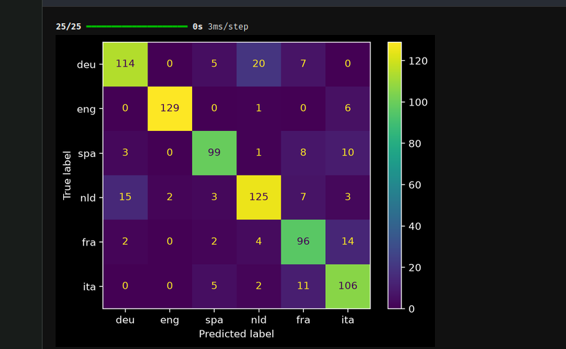

Sujet du 6 octobre, à pusher le lundi 12 octobre avant 12h.

## Environnement de travail.

- n'hésitez pas à avoir un fichier `.py` supplémentaire avec vos fonctions utilitaires pour décharger le notebook

## Classification en 6 langues

- Modifier le chargement des données pour bien avoir 6 langues fait 
- Modifier la structure réseau en conséquence (input et couche de sortie surtout, vous pouvez aussi faire varier la ou les couches cachées) fait 
- Modifier la fonction de loss en conséquence (et la dernière fonction d'activation en `softmax`) fait 

- bonus (long): suivre le même principe en utilisant TextVectorizer de keras (on verra ça la semaine prochaine) pas encore fait 

## Réaliser une évaluation propre 

- diviser correctement le corpus pour avoir des scores valides fait
est ce que la division implique le melange ? ( shuffle et seed ) fait 
- bonus: faire une matrice de confusion fait 

## Expliquer ci-dessous vos difficultés ou posez vos questions

**Observations**

J'ai pu mieux rendre compte de mes confusions/ erreurs en comparant le script donné sur la branch de correction (voir mes notes dans le TP1.md).
J'ai commencé par le MLP en  Keras, l'ajout des label (features), et des langues a identifié a ete plutot simple. Pour adapter le reste du script en concequent j'ai aggrandi le dictionnaire de classes en encodant manuellement les langues ( je ne pense pas que ce soit la solution la plus pertinante).
Il est interessant d'importer le module "random" et de passer le corpus dans shuffle pour le melanger car la partie du corpus sur laquelle on veut entraîner notre modele peu  être tres biaisé en n'ayant qu'une seule ou deux langues. Et l'ajout de seed cela peremet de rendre ce melange reproductible ( garder les même parametres pour chaque entraînements).

Pour les couches de neurones dans Dense je ne sais pas si je peux mettre n'importe quel nombre ?
J'ai essayé avec 8 puis avec 20 les accuracy n'ont pas ete trop differentes.

Pour la loss il faut la changé car on ne cherche plus a avoir du binaire donc on change le 'binary_crossentropy' 'par sparse_categorical_crossentropy' [voir source keras](https://keras.io/api/losses/probabilistic_losses/#categoricalcrossentropy-class) 
Pourquoi j'ai choisi le sparse ? parce que je n'ai pas fait de one hot encoding ( de mon dico classes).

Pour la metrique on se base jusqu'a present sur l'accuracy , mais on veut une matrice de confusion [matrice de confusion keras](https://keras.io/api/metrics/classification_metrics/)
si je comprends bien il faut modifier metrics par : keras.metrics.AUC()]?( ca ne marche pas j'ai eu ce message d'erreur: 
    
    '''
data.shape = [32] does not start with segment_ids.shape = [192]
	 [[{{node UnsortedSegmentSum_1}}]] [Op:__inference_multi_step_on_iterator_195770]
	 
	 '''
)
Ce ce que je constate : 
Ajouter des epochs, des neurones ou une couche cachée supplémentaire n’améliore pas la précision (autour de 66 %, voire moins avec une couche sigmoid). 
Le modèle sous-apprend : entraînement et validation sont proches et moyens. 
La limite viendrait peut etre  des features (6 bigrammes pour 6 langues), et pas de la capacité du réseau?

Je vais donc ajouter plus de bi grammes ?
en ajoutant ces features ci dessous :  j'ai amelioré mon accuracy (autour de 68%- 70%)

    '''

 n_as = text.count("as")
            n_re = text.count("re") 
            n_zu = text.count("zu")
            n_to = text.count("to")
            n_ve = text.count("ve")
            n_iu = text.count("iu")
            
            
    '''
J'ai une variation de l'accuracy a chaque fois que je lance ma cellule c'est peu tre du au fait que ce soit trop aleatoire ? pour essayer decontroler cet effet trop aleatoire et assurer une bonne reproductibilité je peux ajouter un seed comme ce que j'ai fait plus tôt au moment de melanger les données ? [voir doc keras](https://keras.io/examples/keras_recipes/reproducibility_recipes/)

Ca marche, maintenant à chaque fois que je lance la cellule sequential j'ai toujours la meme accuracy.

Au départ, je donnais toutes mes données (`X6_lang`, `y6_lang`) à `model.fit` avec
`validation_split=0.2`, puis je calculais la précision avec
`model.evaluate(X6_lang, y6_lang)`.

L'entraînement lui-même était correct : `validation_split` met 20 % des textes de côté
et les poids ne sont ajustés que sur les 80 % restants. Mais le score que j'affichais
posait deux problèmes :
- Il était calculé en partie sur les données d'entraînement. `evaluate` recevait les
   4 000 textes, dont 80 % avaient servi à ajuster les poids. Un modèle est forcément
   meilleur sur des textes qu'il a déjà vus : ce score mesurait en partie ce que le modèle
   avait retenu, pas sa capacité à reconnaître la langue d'un texte nouveau. Il était donc
   surestimé (par exemple 69,8 % affiché contre 66 % en validation sur une même exécution).
- Je n'avais pas d'ensemble de test séparé. Je comparais mes différents réglages
   (activation, nombre de neurones, epochs) avec la précision de validation et je gardais
   le meilleur. À force de choisir les réglages en fonction de ces textes-là, la validation
   devient elle aussi légèrement optimiste. Il faut un ensemble qui n'intervient dans
   aucune décision pour obtenir une mesure honnête.

**La correction**

Je découpe maintenant le corpus en trois parties avant l'entraînement :

- test (20 %) : mis de côté avec `train_test_split`, utilisé une seule fois à la fin ;
- entraînement (64 %): sert à ajuster les poids ;
- validation (16 %): prise dans l'entraînement via `validation_split`, sert à comparer
  mes essais.

+ J'utilise `stratify=y6_lang` pour que chaque langue soit représentée dans les mêmes
proportions dans l'entraînement et le test, et `random_state=0` pour que le découpage soit
reproductible. [scikit](https://scikit-learn.org/stable/modules/generated/sklearn.model_selection.train_test_split.html)

**Quel activation choisir:** [source](https://metricgate.com/blogs/fr/relu-vs-sigmoid-vs-tanh-activation/)
- La sigmoïde conserve une utilité avérée : en tant que fonction d'activation de sortie d'un classifieur binaire 
- Tanh adapté pour : Les états cachés des réseaux récurrents (RNN standards, activations candidates au sein des GRU).
Les architectures peu profondes, dans lesquelles la saturation n'atteint pas un seuil critique.
Toutes les configurations nécessitant une non-linéarité lisse, bornée et centrée sur zéro.
- Relu :  environ 50 % des unités prennent une valeur nulle sous une entrée distribuée aléatoirement, ce qui réduit la charge de calcul et favorise souvent une meilleure généralisation.

**Matrice de confusion**
Pas trouvé dans Keras mais Dans Sickit Learn [voir](https://scikit-learn.org/stable/modules/generated/sklearn.metrics.ConfusionMatrixDisplay.html)

Pour conclure : 

Le modele a tendance a bien classé lorsqu'il s'agit de l'anglais seulement 7 erreur  et 126 bonne classification.
Pour l'allemand c'est un peu moin performant : 114 sont bien classé, il se trompe souvant en les classant dans le nld 20 , un peu en espagnol 5 et francai 7 
L'espagnol : 98 sont bien classés mais il confond pas mal en les mettant sous le label italien 10 ou francais 8.
Néerlandais: 125 sont bien labelisés, mais il a tendance a classé sous l'etiquette allemand 15 et aussi français 7 et un peu aussi dans les autres langues.
Français: 97 sont bien labelisés mais le modele a tendance a se tromper en les categorisant comme italien 14, et un peu dans les autres label sauf anglais.
Italien: 107 sont bien labelisés mais il s'est trompe en labelisant 11 comme etant du français et un peu en nld et espagnol.

Donc le model est globalement assez bon mais il a du mal a correctement reconnaitre le francais,le neerlandais,et l'allemand.

Pour ameliorer la performance il faut surement ajouter encore plus de bigrammes? Plus de features propres à chaque langue proche (voyelles doubles et ij pour le néerlandais, ou ou eu pour le français, zz ou gl pour l’italien, ñ pour l’espagnol??
Ou bien je suppose qu'en utilisant TextVectorizer on aurait plus besoin des bi gramme en entree et ce module vectorise directmeent a partir du text et donne un index fixe a chaque mot ce qui ameliorerait drastiquement la performance du modele ?( meme si je ne l'ai pas encore fait)

